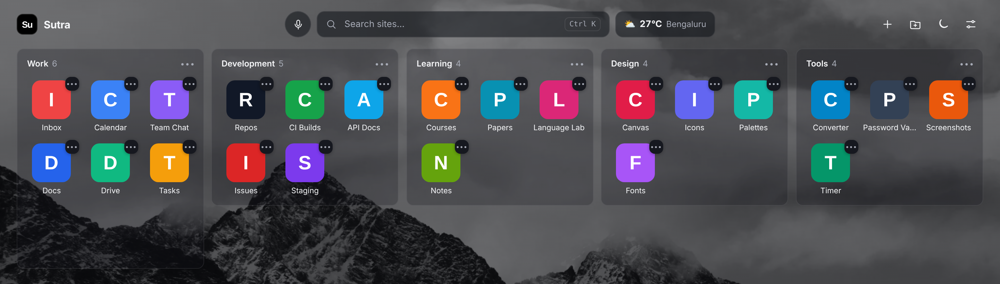
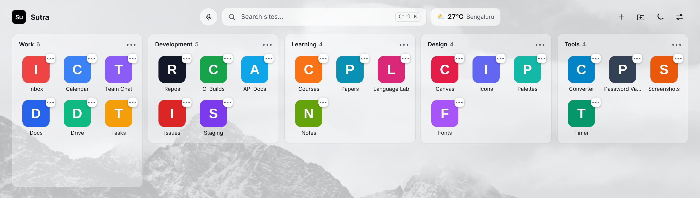
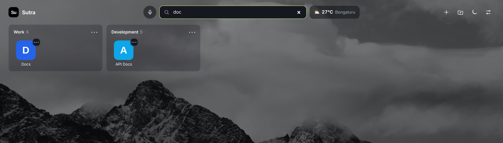
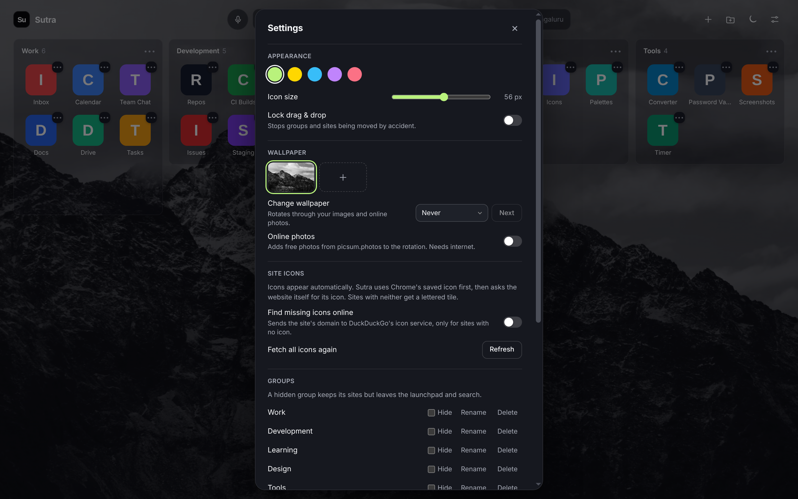
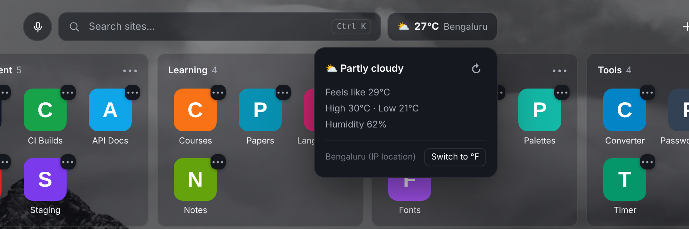

  

<h1 align="center">Sutra</h1>

  <strong>सूत्र · "thread"</strong> 
  The fast, beautiful new tab that keeps every site you use one click away.

  
  
  
  
  
  

  
  
  

  

---

## Your bookmarks, finally within reach

Browser bookmark menus are slow to open and easy to forget. **Sutra replaces your new tab with a clean launchpad**: your sites in tidy groups, with real icons, instant search and local weather.

> **Example:** open a new tab, press **Ctrl K**, type `doc`. Every matching site across all groups stays, the rest fade away. Press **Enter** to open, or to search the web when nothing matches.

## What you get

| | Feature | What it means |
| --- | --- | --- |
| 🗂️ | **Groups** | Work, Development, Learning, or your own. Drag to reorder, hide, rename. |
| 🖼️ | **Automatic icons** | Chrome's saved icon first, then the site's own icon, then a lettered tile. |
| 🔎 | **Instant search** | **Ctrl K**, filters as you type. Enter searches the web. |
| 🎙️ | **Voice search** | Optional, one tap on the microphone. |
| ⛅ | **Local weather** | Temperature, feels-like, high and low. °C or °F. |
| 🎨 | **5 accent colours** | Emerald, Gold, Cyan, Violet, Crimson. Light and dark themes. |
| 🌄 | **Wallpapers** | Use your own images, or rotate every tab, minute or hour. |
| 📥 | **Import from Chrome** | Copies your bookmarks and folders. Chrome's own stay untouched. |
| 💾 | **Backups** | JSON export, plus an automatic **Sutra Backups** folder with 7 daily copies. |
| 🧹 | **Duplicate cleaner** | Finds repeated sites and removes them in one click. |
| 🔒 | **Drag lock** | Stops sites being moved by accident. |

  

## Search that stays out of your way

  

## Make it yours

  

  

## Private by design

| Sutra never... | Detail |
| --- | --- |
| tracks you | No analytics, no telemetry, no ads, no affiliate links |
| uploads your library | Bookmarks, notes and groups never leave your device |
| runs remote code | Everything is packaged inside the extension (Manifest V3) |
| asks for more than it needs | Core permissions: `storage`, `favicon`, `unlimitedStorage` |

**Be clear about the network.** Sutra is not offline-only. These are the only requests it makes:

| Request | When | What the service sees |
| --- | --- | --- |
| Weather (`get.geojs.io`, `ipapi.co`, `api.open-meteo.com`, `wttr.in`) | Weather widget | Your IP address, for an approximate location. Cached 30 minutes. |
| The website's own icon | A site has no icon saved in Chrome | The request, with no referrer |
| Chrome speech recognition | Only when you tap the microphone | Audio goes to Google, under Google's policy |
| `picsum.photos` | **Off by default.** "Online photos" setting | Nothing about you or your library |
| `icons.duckduckgo.com` | **Off by default.** "Find missing icons online" | The site's domain only |

`bookmarks` permission is **optional** and asked only when you click **Import from Chrome**. Full details: [privacy-policy.html](privacy-policy.html).

## Install in 1 minute

1. Click **Code → Download ZIP** on this page, then unzip it.
2. Open `chrome://extensions` and turn on **Developer mode** (top right).
3. Click **Load unpacked** and select the unzipped folder (the one containing `manifest.json`).
4. Open a new tab. Sutra is there.
5. Click **+** to add a site, or **Settings → Import from Chrome**.

> Keep the folder in place after loading. Chrome runs the extension from it.

## FAQ

**Will it delete my Chrome bookmarks?** No. Import only copies them.

**Where is my data?** In your browser's local storage, and in your backup folder if you choose one. Uninstalling Sutra removes the local copy.

**Can I move to another computer?** Yes. Export a JSON backup, then import it there. Importing adds to your library and skips duplicates.

**Does it replace my new tab page?** Yes, that is its purpose. Disable the extension to get Chrome's default back.

**Which browsers?** Chrome 111+, and Chromium browsers such as Edge and Brave.

## About Devnetra Consultancy

<table>
  <tr>
    <td width="170" align="center" valign="middle">
      <picture>
        <source media="(prefers-color-scheme: dark)" srcset="docs/brand/devnetra-logo-white-text.svg">
        
      </picture>
    </td>
    <td valign="middle">
      <strong>Devnetra Consultancy</strong> designs and builds thoughtful, privacy-first software. 
      Sutra is our answer to a simple question: why should your own shortcuts be slow to reach?  
      🎯 <strong>Focus:</strong> fast, private tools that respect your data 
      🛡️ <strong>Promise:</strong> no tracking, no ads, your library stays on your device 
      📧 <strong>Contact:</strong> <a href="mailto:devnetraconsultancy@gmail.com">devnetraconsultancy@gmail.com</a> for support, feedback, partnerships or licensing
    </td>
  </tr>
</table>

If Sutra saves you time, tell a friend who lives in too many tabs.

## License

Copyright © 2025-2026 Devnetra Consultancy. All rights reserved. Proprietary software, see [LICENSE.txt](LICENSE.txt).
Copying, modifying or redistributing any part without written permission is prohibited.

---

<strong>For developers</strong>

| File | Purpose |
| --- | --- |
| `manifest.json` | MV3 manifest, new-tab override |
| `dashboard.html` / `dashboard.js` / `style.css` | The launchpad UI and logic |
| `boot.js` | Early theme and wallpaper bootstrap |
| `privacy-policy.html` | Full privacy policy |
| `docs/screenshots/` | Real screenshots. Site names, icons and weather are sample data. |

No build step. Load the folder unpacked.

