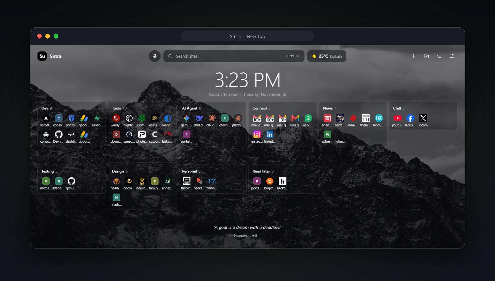
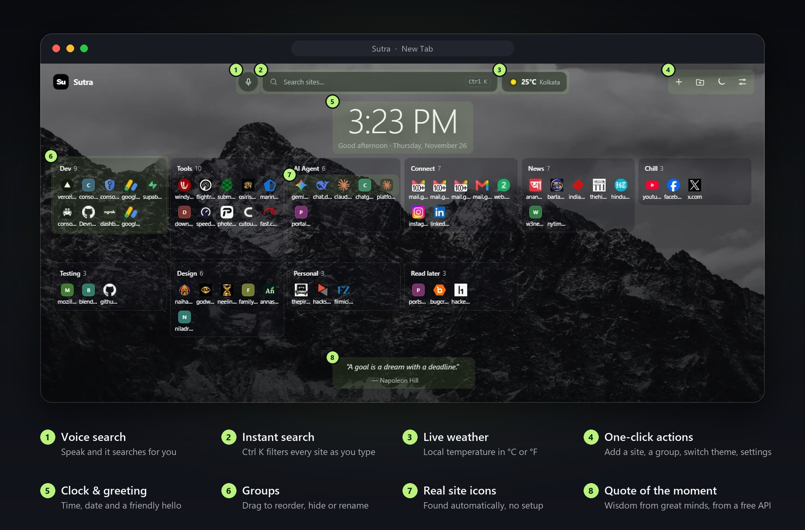
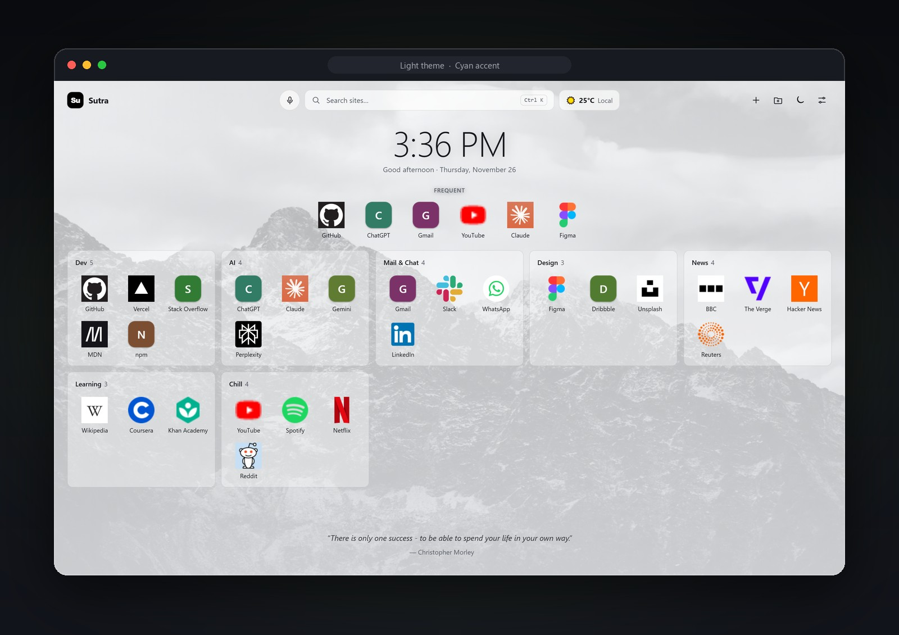
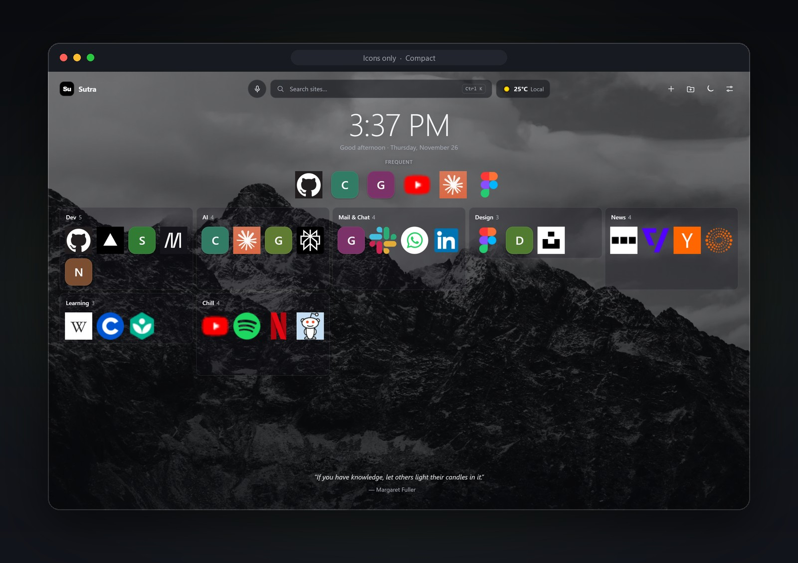
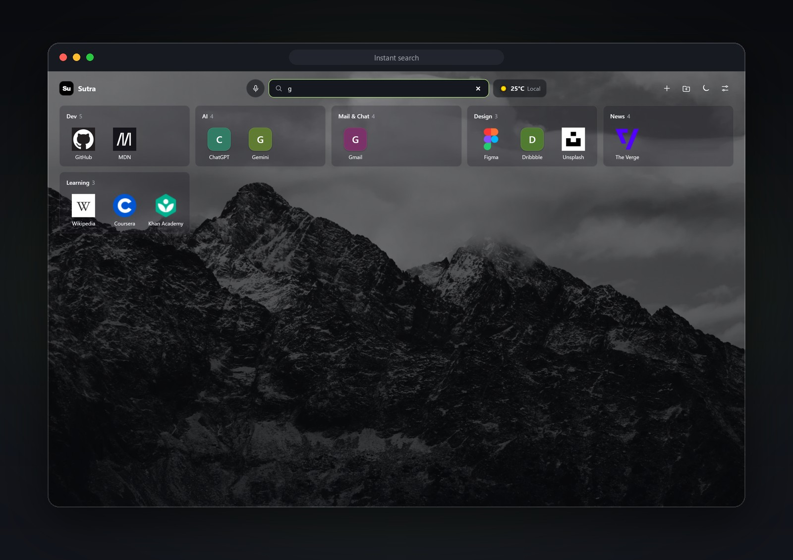
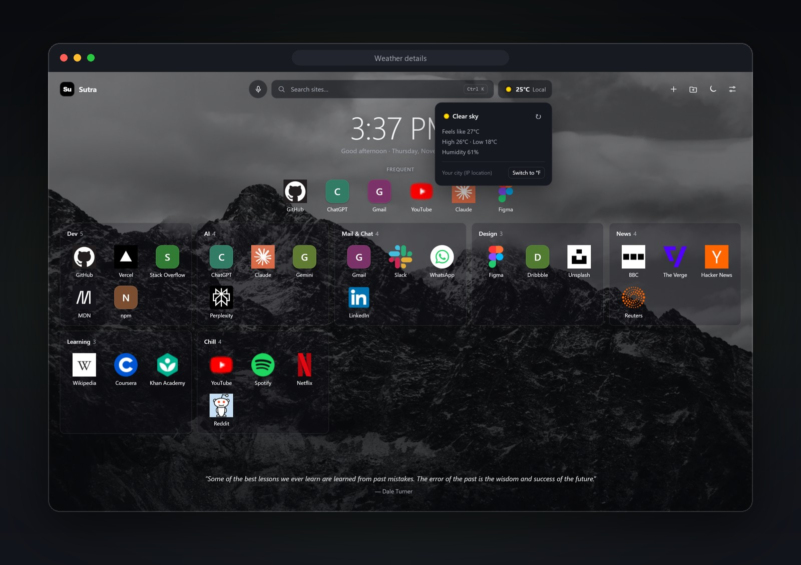
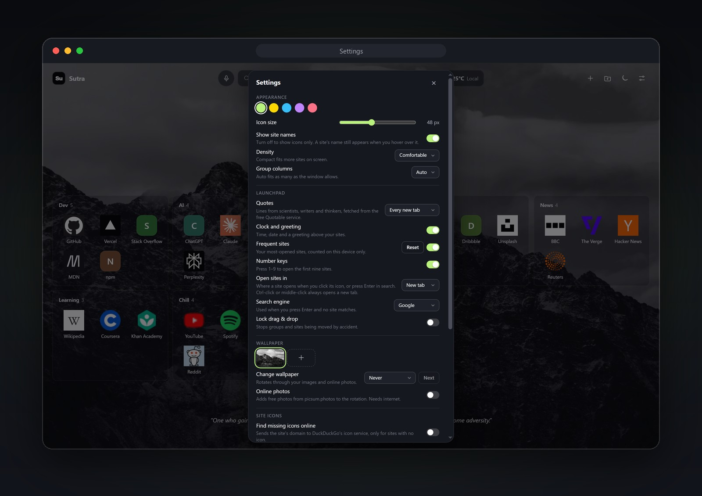

<div align="center">


# Sutra

**The fast, private new tab that keeps every site one click away.**

<sub>सूत्र · *“thread”* — the line that ties your web together</sub>

<br>

[](https://github.com/DevnetraConsultancy/Sutra-Fast-Bookmark-Manager/releases/latest)
[](LICENSE.txt)
[](manifest.json)
[](#install)
[](#for-developers)
[](#privacy)
[](https://github.com/DevnetraConsultancy/Sutra-Fast-Bookmark-Manager/stargazers)

[**Download**](https://github.com/DevnetraConsultancy/Sutra-Fast-Bookmark-Manager/releases/latest) &nbsp;·&nbsp;
[Tour](#a-quick-tour) &nbsp;·&nbsp;
[Features](#features) &nbsp;·&nbsp;
[Install](#install) &nbsp;·&nbsp;
[Privacy](#privacy) &nbsp;·&nbsp;
[Changelog](CHANGELOG.md)

<br>



</div>

<br>

<table>
<tr>
<td width="33%" valign="top">

### ⚡ Fast
Opens with your last launchpad already on screen, then refreshes in the background. No frameworks, no build, no waiting.

</td>
<td width="33%" valign="top">

### 🛡️ Private
Your library never leaves your device. No accounts, no analytics, no ads. Every network request is listed [below](#privacy).

</td>
<td width="33%" valign="top">

### ✨ Beautiful
Real site icons, wallpapers, light and dark themes, five accents, a clock and a quote to start each tab well.

</td>
</tr>
</table>

## A quick tour



## Features

<table>
<tr>
<td width="50%" valign="top">

**Launchpad**
- 🗂️ **Groups** you can drag, reorder, hide and rename
- 🖼️ **Real site icons**, found automatically, lettered tile as fallback
- ⭐ **Frequent sites** row, counted on this device only
- 🕒 **Clock and greeting** with today's date
- 💬 **Quotes** from scientists, writers and thinkers
- ⛅ **Local weather** with feels-like, high, low and humidity

</td>
<td width="50%" valign="top">

**Speed and control**
- 🔎 **Instant search** with <kbd>Ctrl</kbd> <kbd>K</kbd>, Enter searches the web
- 🌐 **Your search engine**: Google, Bing, DuckDuckGo or Brave
- 🔢 **Number keys** <kbd>1</kbd>–<kbd>9</kbd> open your first nine sites
- 🎙️ **Voice search**, one tap on the microphone
- ↗️ **Same tab or new tab**, your choice
- 🔒 **Drag lock** so nothing moves by accident

</td>
</tr>
<tr>
<td width="50%" valign="top">

**Make it yours**
- 🎨 Light and dark themes, five accent colours
- 🧩 **Icons-only** mode and a **compact** density
- 📐 Fixed number of group columns, or automatic
- 🌄 Your own wallpapers, or free online photos, rotating on a timer

</td>
<td width="50%" valign="top">

**Your library, safe**
- 📥 **Import from Chrome** without touching Chrome's bookmarks
- 💾 **Backups**: JSON export plus an automatic folder with 7 daily copies
- 🧹 **Duplicate cleaner** in one click
- 📴 Works offline, quietly, without error noise

</td>
</tr>
</table>

## Gallery

<table>
<tr>
<td width="50%"><p align="center"><sub><b>Light theme</b> · cyan accent</sub></p></td>
<td width="50%"><p align="center"><sub><b>Icons only</b> · compact density</sub></p></td>
</tr>
<tr>
<td width="50%"><p align="center"><sub><b>Instant search</b> · filters as you type</sub></p></td>
<td width="50%"><p align="center"><sub><b>Weather</b> · details at a click</sub></p></td>
</tr>
</table>

<p align="center">
  <br>
  <sub><b>Settings</b> · everything on one calm, compact panel</sub>
</p>

## Keyboard shortcuts

| Keys | Action |
| --- | --- |
| <kbd>Ctrl</kbd> <kbd>K</kbd> | Focus search |
| Just start typing | Search from anywhere on the page |
| <kbd>Enter</kbd> | Open the first match, or search the web |
| <kbd>1</kbd> – <kbd>9</kbd> | Open one of the first nine sites |
| <kbd>↑</kbd> <kbd>↓</kbd> <kbd>←</kbd> <kbd>→</kbd> | Move between sites |
| <kbd>Esc</kbd> | Clear the search or close a menu |
| <kbd>Ctrl</kbd> + click, middle-click | Open a site in a background tab |

## Install

**From a release (recommended)**

1. Download **`Sutra-vX.Y.Z.zip`** from the [latest release](https://github.com/DevnetraConsultancy/Sutra-Fast-Bookmark-Manager/releases/latest) and unzip it.
2. Open `chrome://extensions` and turn on **Developer mode** (top right).
3. Click **Load unpacked** and choose the unzipped folder, the one with `manifest.json` in it.
4. Open a new tab. Click **+** to add a site, or go to **Settings › Library › Import from Chrome**.

> [!TIP]
> Keep the folder where it is after loading: Chrome runs the extension from it. Works in Chrome 111+, Edge and Brave.

## Privacy

| Sutra never… | |
| --- | --- |
| tracks you | No analytics, no telemetry, no ads, no affiliate links |
| uploads your library | Sites, notes and groups stay on your device |
| runs remote code | Everything ships inside the extension (Manifest V3) |
| asks for more than it needs | `storage`, `favicon`, `unlimitedStorage`; `bookmarks` only when you import |

Sutra is not offline-only, and says exactly what it fetches:

| Request | When | What the service sees |
| --- | --- | --- |
| Weather: `get.geojs.io`, `ipapi.co`, `api.open-meteo.com`, `wttr.in` | Weather widget, cached 30 minutes | Your IP address, for an approximate location |
| A site's own icon | Only when Chrome has no icon saved for it | The request, with no referrer |
| Quotes: `api.quotable.kurokeita.dev` (fallback `dummyjson.com`) | Quote line, 50 at a time; can be turned off | Nothing about you or your library |
| `picsum.photos` | **Off by default.** Online photos | Nothing about you or your library |
| `icons.duckduckgo.com` | **Off by default.** Find missing icons online | The site's domain only |
| Chrome speech recognition | Only when you tap the microphone | Audio, under Google's policy |

Full details in the [privacy policy](privacy-policy.html).

## FAQ

<details>
<summary><b>Will it change or delete my Chrome bookmarks?</b></summary>
<br>No. Importing only copies them. Chrome's own bookmarks stay exactly as they are.
</details>

<details>
<summary><b>Where is my data, and how do I move it to another computer?</b></summary>
<br>In your browser's local storage, and in your backup folder if you choose one. Export a JSON backup and import it on the other computer, or point Sutra at the same backup folder. Importing adds to your library and skips duplicates.
</details>

<details>
<summary><b>How do I get Chrome's normal new tab back?</b></summary>
<br>Turn Sutra off in <code>chrome://extensions</code>.
</details>

<details>
<summary><b>Can I turn off the clock, quotes or frequent sites?</b></summary>
<br>Yes. Everything is in <b>Settings › Launchpad</b>, including how often the quote changes.
</details>

## For developers

No build step and no dependencies: plain HTML, CSS and JavaScript.

```
manifest.json         Manifest V3, new-tab override
dashboard.html        Page markup
dashboard.js          Launchpad logic (storage, rendering, settings, sync across tabs)
boot.js               Applies theme, layout and wallpaper before first paint
style.css             Styles
privacy-policy.html   Privacy policy
docs/showcase/        README images (demo data, except the hero and tour)
```

Clone, then **Load unpacked** the repository folder. See [CONTRIBUTING.md](CONTRIBUTING.md) for the workflow and checks, and [SECURITY.md](SECURITY.md) to report a vulnerability.

## About

<table>
  <tr>
    <td width="170" align="center" valign="middle">
      <picture>
        <source media="(prefers-color-scheme: dark)" srcset="docs/brand/devnetra-logo-white-text.svg">
        
      </picture>
    </td>
    <td valign="middle">
      <strong>Devnetra Consultancy</strong> designs and builds thoughtful, privacy-first software.<br>
      Sutra answers a simple question: why should your own shortcuts be slow to reach?<br><br>
      📧 <a href="mailto:devnetraconsultancy@gmail.com">devnetraconsultancy@gmail.com</a> · support, feedback and partnerships
    </td>
  </tr>
</table>

<div align="center">

<br>

If Sutra saves you time, ⭐ the repository and tell a friend who lives in too many tabs.

<sub>Released under the <a href="LICENSE.txt">MIT License</a> · © 2025-2026 Devnetra Consultancy</sub>

</div>
